# patkb

This repo is the result of my custom keyboard build.
The keyboard is a split keyboard inspired by the [SofleKeyboard](https://github.com/josefadamcik/SofleKeyboard) without the top row.
The first version was handwired onto two [nice!nano v2](https://nicekeyboards.com/nice-nano/) controllers
(that version used a hotswap-socket holder plate, see the photos below).
This version is a **custom PCB** per half with a bare nRF52840, a rotary encoder, a Sharp memory LCD,
a LiPo charger and a fuel gauge. The keyboard is programmed with the ZMK firmware including a custom board and shield.

This repo is holding the 3D-files, the ZMK board and shield for the PCB, the keymap and the bootloader notes.

## The hardware

Each half is one PCB. The right PCB is the left one flipped, so the columns of the right half run from right to left.

| Part | Notes |
|---|---|
| nRF52840 (QIAA, 1 MB flash) | bare chip with 32.768 kHz crystal, DC/DC inductors fitted, wired antenna at the PCB edge |
| Kailh Choc V2 low-profile switches + hotswap sockets | 22 per half |
| 1N4148-type diodes | one per switch, `col2row` |
| PEC11R-4215F-S0024 rotary encoder | 24 pulses/24 detents per rotation, one per half, with push button |
| Sharp memory LCD LS013B7DH03 | 128x128, monochrome, one per half |
| BQ24075 LiPo charger | the power switch is wired to its `SYSOFF` pin; `CHG`/`PGOOD` are not connected to the nRF |
| MAX17048 fuel gauge | I2C address `0x36` (the firmware does not report the battery level yet) |
| 3.7 V LiPo battery | one per half |

3D-files (from the handwired version): [Top plate left](3d-files/TopPlat_Left.stl), [Case left](3d-files/Case_Left.stl).
The images below show the first, handwired build.

### Pin assignments

The PCB has no pro_micro header, so the shield uses the nRF GPIOs directly (`&gpio0` = P0.xx, `&gpio1` = P1.xx).

| Function | Pin |
|---|---|
| Matrix rows 0-3 (both halves) | P0.26, P0.04, P0.06, P0.08 |
| Matrix columns c1..c6 (left half, left to right) | P1.10, P1.13, P1.15, P0.02, P0.29, P0.31 |
| Matrix columns (right half, left to right = c6..c1) | P0.31, P0.29, P0.02, P1.15, P1.13, P1.10 |
| Encoder A / B (left) | P0.20 / P0.22 |
| Encoder A / B (right, mirrored pcb) | P0.22 / P0.20 |
| Encoder push button (both) | P0.24 (active low, internal pull-up) |
| LCD `SCLK` / `SI` / `SCS` / `DISP` / `EXTCOMIN` | P1.01 / P1.02 / P1.04 / P1.07 / P1.06 |
| Fuel gauge `SDA` / `SCL` | P0.12 / P1.09 |
| Reset button | P0.18 (double-tap enters the bootloader) |

The matrix is `col2row` with 12 columns x 4 rows (the left half uses columns 0-5, the right half 6-11).
The two encoder push buttons are extra keys at matrix positions `RC(0,12)` (left) and `RC(0,13)` (right).
If you change the pins, edit `boards/shields/patkb/patkb_left.overlay` / `patkb_right.overlay`
(and `patkb.dtsi` for the matrix transform); those files are the source of truth, not this table.

## The software

The repo contains a [ZMK](https://zmk.dev) module for **patkb** with
- a custom board `patkb_pcb` (`boards/arm/patkb_pcb/`) for the bare nRF52840: flash layout of the bootloader, clocks, DC/DC, USB and the Sharp LCD,
- a shield `patkb` (`boards/shields/patkb/`) with the matrix, encoders, the left/right differences and the keymap.

`config/west.yml` and `.github/workflows/build.yml` pull in ZMK `v0.3` at build time (`v0.3` is needed so
the right encoder's events are forwarded to the left half, which is the central). ZMK itself is not part of this repo.

### Bootloader

The chip runs the [Adafruit nRF52 bootloader](https://github.com/adafruit/Adafruit_nRF52_Bootloader) with a custom `patkb` board
(`flash_the_keyboard/Adafruit_nRF52_Bootloader/src/boards/patkb`). It has no LED or DFU button; the reset button on P0.18 is
double-tapped to enter the bootloader, which shows up as the `PATKBBOOT` USB drive. The bootloader uses SoftDevice s140 6.1.1,
so the application starts at `0x26000` (same flash layout as the nice!nano).

### Keymap

The keymap (`boards/shields/patkb/patkb.keymap`) uses a German (`locale/keys_de.h`)
layout and defines 4 layers:

- **default** - base QWERTY layer, home-row mods/layer-taps on `A S D F` /
  `H J K L Ö` (hold for layer or shift, tap for the letter).
- **first** (`&lt FIRST ...`) - symbols and punctuation (`@ " € ~ '`, brackets,
  math operators, etc).
- **second** (`&lt SECOND ...` / thumb key) - navigation (arrows, page up/down),
  media/volume, screenshot, clipboard (cut/copy/paste).
- **num** - numpad-style digit layer.

Both rotary encoders control the volume on every layer (clockwise = louder) and pushing them is mute.

Two custom hold-tap behaviors are defined:

- `lt` (layer-tap): hold for a layer, tap for a key.
- `mt` (mod-tap): hold for a modifier, tap for a key.

Both use `flavor = "balanced"` with a 280 ms tapping term and a 150 ms
require-prior-idle, tuned to avoid misfires while typing fast.

### Display

Each half has a Sharp memory LCD (128x128) showing ZMK's built-in status screen. The fuel gauge is wired
but battery reporting is not implemented yet.

### Layout

This diagram is generated automatically from `boards/shields/patkb/patkb.keymap`
using [`keymap-drawer`](https://github.com/caksoylar/keymap-drawer): every push
that touches the keymap, the shield's devicetree, `keymap_drawer.config.yaml` or the physical layout
triggers `.github/workflows/draw-keymaps.yml`, which re-renders
`keymap-drawer/patkb.svg` and commits it back.

The physical layout is defined in `keymap-drawer/patkb_layout.json` (key positions in the same order as the matrix
transform in `patkb.dtsi`: the 44 matrix keys, then the left and right encoder buttons in the gap between the halves).
If the physical layout or the key order changes, update that file.

German (`DE_*`) key codes and the custom `lt`/`mt` hold-tap behaviors are
resolved into readable legends via `keymap_drawer.config.yaml`.

### Building firmware

Push this repo to GitHub. `.github/workflows/build.yml` uses ZMK's reusable
`build-user-config.yml` workflow, driven by `build.yaml`, to build on every
push/PR. It produces three firmware artifacts:

- `patkb_left` (with ZMK Studio support, central)
- `patkb_right` (peripheral)
- `settings_reset` (utility firmware to clear paired-bond/settings storage)

Download the `.uf2` files from the Actions run's artifacts once it finishes.

### Flashing

Put each half into bootloader mode (double-tap the reset button), and copy the matching `.uf2` file
(`patkb_left` / `patkb_right`) onto the `PATKBBOOT` drive that appears. The first time, also flash `settings_reset`
to both halves, then the real firmware, so the halves pair cleanly. See ZMK's
[flashing docs](https://zmk.dev/docs/development/local-toolchain/build-flash#flashing)
for details.

### Changing the keymap

1. Edit `boards/shields/patkb/patkb.keymap`.
2. Push — CI rebuilds and produces new `.uf2` artifacts, and the layout diagram in the [Layout](#layout) section is
   automatically re-rendered.
3. Reflash both halves.

Alternatively, since ZMK Studio is enabled on `patkb_left`, simple binding
changes can be made live from the [ZMK Studio](https://zmk.studio) app while
connected via USB, without rebuilding/reflashing.
